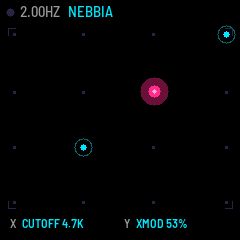
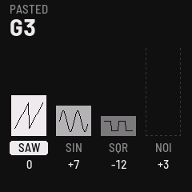
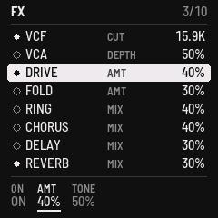
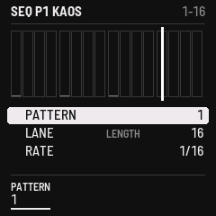

# MODELAR

A semi-modular drone synth for the M-VAVE FM-1, played like a Kaoss Pad. Four oscillators sound all the time and
modulate each other. The keyboard plays no notes: it moves a cursor on an XY pad that opens the filter, drives the
cross-modulation and brings the effects in, softly. Think of a Moog Labyrinth wired to a Korg Kaoss Pad.

 
 

- **4 oscillators**, 12 waves each (sine, triangle, saw, square, pulse, supersaw, noise, S&H, morph, 2-op FM,
  formant, chaos), 8 routings (mix, pairs FM, chain FM, ring, sync, cross, AM, feedback ring)
- **The pad**: the 16 white keys are a 4 × 4 grid of points. Hold several and the cursor sits between them. The
  effect fades in on a touch and out on release, and RANGE keeps it from getting harsh.
- **11 gestures** on the black keys: circle, eight, sweeps, diagonal, spiral, tremolo, random walk, bounce, jump,
  return. Hold a key to play a gesture, or latch it with SEL.
- **Stereo FX chain**: VCF (LP/BP/HP), drive, fold, ring, crush, VCA tremolo, chorus, delay, reverb
- **A clock in Hz**, not BPM, like a modular: internal, MIDI or OSC4, with swing, jitter and tap tempo
- **ARP** over the held points (six modes, including ORBIT). **SEQ** with 8 patterns, a KAOS lane and four OSC lanes,
  each with its own length (polymeters), live or step recording, and mutation.
- **8 generative environments** with drift and random events, 2 LFOs, per-key settings, 16 patch slots and a quick
  backup

Status: **0.3, beta**. Built on [fm1-base](https://github.com/charlesvestal/fm1-base) and felucca-bsp.

## Install

Use the web installer on [The Firmware Hub](https://thefirmwarehub.com/) (Chrome or Edge), or from the command line
(`pip3 install mido python-rtmidi`):

    python3 base/tools/fm1_install.py modelar-0.3.fwsc

To leave MODELAR, install any other firmware the same way (the official V15 included). Hold **OCT−** and **OCT+**
for 5 seconds for the update mode.

Tested on a real FM-1 (0.3): installed over V15 and over Felucca, and left again for V15 and for Felucca; it shows
as a USB MIDI device and answers the identity request with FM-1_42000300.

### What it keeps, and what it overwrites

MODELAR keeps its patches in the FM-1's flash data area (0x97000–0xC9FFF: 16 slots and a backup), the panel calibration at 0xDC000, and its system
settings in the settings sector pair at 0xFC000. It cannot read projects, presets or samples saved by other
firmwares, and installing it may overwrite what they kept in those areas. **Back up first.** A firmware installed
after MODELAR may overwrite its patches in the same way.

## First sound

1. Power on. The volumes always start at 0, so nothing sounds yet.
2. Raise **MASTER**, then **K1–K4**: each one fades an oscillator in.
3. Touch a white key. The cursor glides there and the effect fades in.
4. Hold two white keys. The cursor sits between them.
5. Hold a black key. The cursor draws a gesture on its own.
6. Press **HOME** for the four bars: volume, wave and tone of each oscillator.

## The controls

**SEL** is SHIFT. Hold it, or tap it twice to lock it (its LED blinks) and tap once more to release.
**K1–K4** are always the four volumes, on every page.

| Control | Alone | With SEL | On a page |
| --- | --- | --- | --- |
| MASTER | Main volume | | |
| SELECT | Active oscillator (1–4) | Clock rate in Hz | Rows |
| PRESETS | Wave of the active oscillator | Load the next or previous patch | Parameters of the row |
| ALGO | Routing (1–8) | FX dry/wet | Value |
| K1–K4 | Oscillator volumes | Fine tune, ±50 cents | Oscillator volumes |
| OCT− / OCT+ | Tone of the active oscillator, ±1 semitone (hold to repeat) | ±1 octave | |
| OCT− + OCT+ | Tone back to 0 | All four back to 0 | |
| FX ENV LFO EDIT GLO ARP SEQ | Open or close the page (hold: open while held) | Bypass FX · Mutate · LFO sync · EDIT defaults · Copy key · ARP on/off · Pick pattern | |
| HOME | KAOS PAD ↔ bars; back from a page | SYSTEM page | |
| SAVE | Save the patch into its slot | Slots: load, save, rename (held 2 s: quick backup) | |
| PLAY | Start / stop | Tap tempo | |
| REC | Record: live while playing, step by step while stopped | Clear the active lane (+ PLAY: the whole pattern) | |

| Keys | Alone | With SEL | On the SEQ page |
| --- | --- | --- | --- |
| White (16) | Points of the pad. The group of four sets Y, the place in the group sets X. | HOLD: the cursor stays | Steps 1–16 of the page. Tap to switch on or off; hold and turn PRESETS/ALGO for Y/X or the tone. |
| Black (11) | Gestures, F#3 → F#5: circle, eight, sweep H, sweep V, diagonal, spiral, tremolo, walk, bounce, jump, return | LATCH (F#5: stop all, release HOLD) | Step pages 1–4, lanes KAOS/OSC1–4, copy page, clear page |

Inside a page, **SELECT** picks the row, **PRESETS** the parameter and **ALGO** the value.

- **FX**: VCF (cutoff, resonance, mode), VCA (depth, rate, shape), drive, fold, ring, chorus, delay (time in note
  values), reverb, crush, FX level
- **ENV**: the environment (CALMA, NEBBIA, MAREA, FORESTA, VETRO, RUGGINE, COSMO, TEMPESTA), drift, drift speed,
  mutation, density
- **LFO**: two LFOs (shape, rate free or synced, destination, amount; they can move the cursor too), and the clock
  (rate, source, swing, jitter)
- **EDIT**: two destinations each for X and Y, with ± amounts; slew, attack and release, release mode
  (fade, stay, return), range, curve, gesture size and speed
- **GLO**: press a key to set it up. White keys: point, intensity, oscillators, own X/Y destinations, snapshot.
  Black keys: gesture, speed, size, centre, intensity, oscillators, own X/Y.
- **ARP**: mode, rate, gate, glide, swing, latch, spread
- **SEQ**: pattern, lane length and mutation, rate, swing, direction
- **SYSTEM** (SEL + HOME): MIDI channel, MIDI notes, CC out, pad colours (NEON, ACIDO, LAVA), lights, version,
  audio load

**MIDI.** Clock in, with start and stop. CC in: 12 X, 13 Y, 14–17 volumes, 21–24 waves, 70 algo, 71 resonance,
74 cutoff, 91 reverb, 93 chorus, 94 delay. With CC OUT on, X, Y and the four volumes go out on CC 12–17 over USB.

## Build

    git clone --recurse-submodules https://github.com/hirakos999/MODELAR.git
    ./build.sh                       # app/build/modelar.fwsc
    ./build.sh --release 0.3         # app/build/modelar-0.3.fwsc, identity FM-1_42000300
    ./build.sh --host && app/build/host/modelar_host app/tests/basic.txt app/build/host   # tests, screenshots, WAV
    ./build.sh --web                 # the browser emulator: app/build/emu/

The prerequisites (Docker on macOS, the JieLi toolchain, the AC79 SDK, Python with Pillow) are in fm1-base's README.
Package identity: **FM-1_42** (development builds FM-1_4200, releases FM-1_42XXYYZZ).

## Licence

MODELAR is MPL-2.0 ([LICENSE](LICENSE)). It is built on [fm1-base](https://github.com/charlesvestal/fm1-base) by
Charles Vestal (MPL-2.0) and felucca-bsp, from [Felucca](https://github.com/hugelton/Felucca) by Leo Kuroshita
(Hügelton Instruments). The fonts and the JieLi SDK files keep their own licences (fm1-base's LICENSING.md).

Installing firmware is at your own risk.

You can also try MODELAR in the browser, no flashing needed, in the free community [FM-1 Emulator](https://fm1-emulator.atst.tools/).
